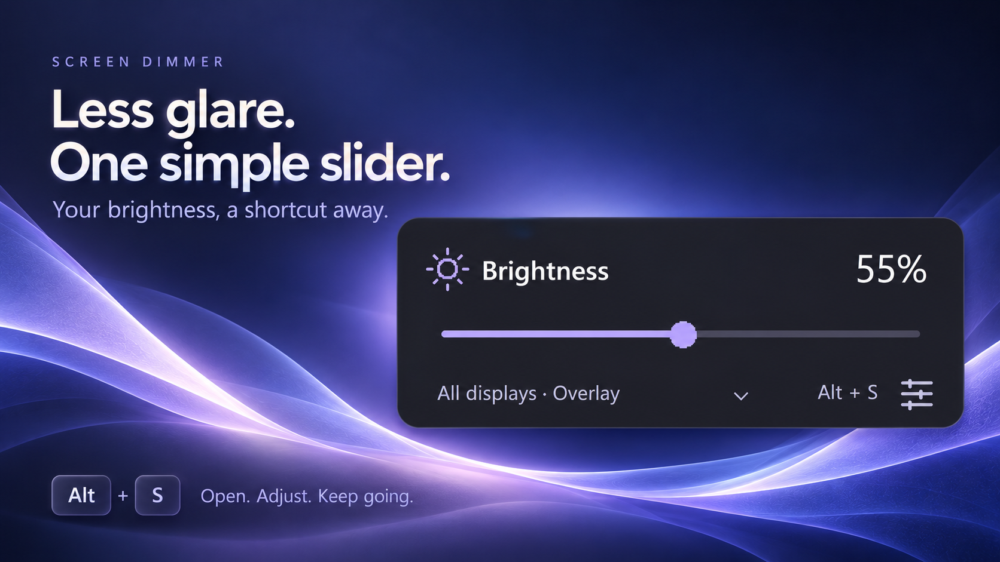
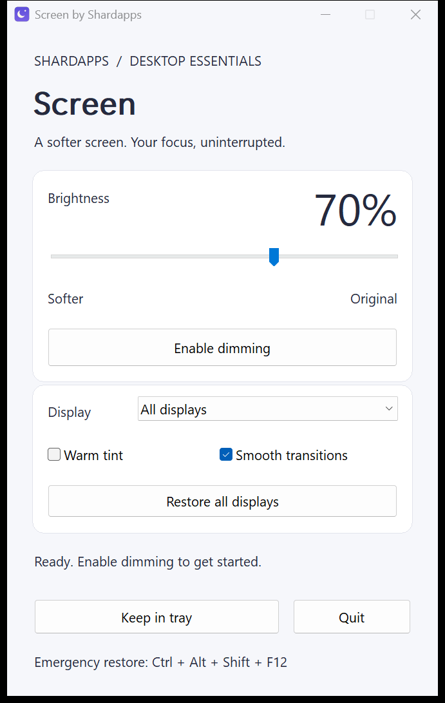
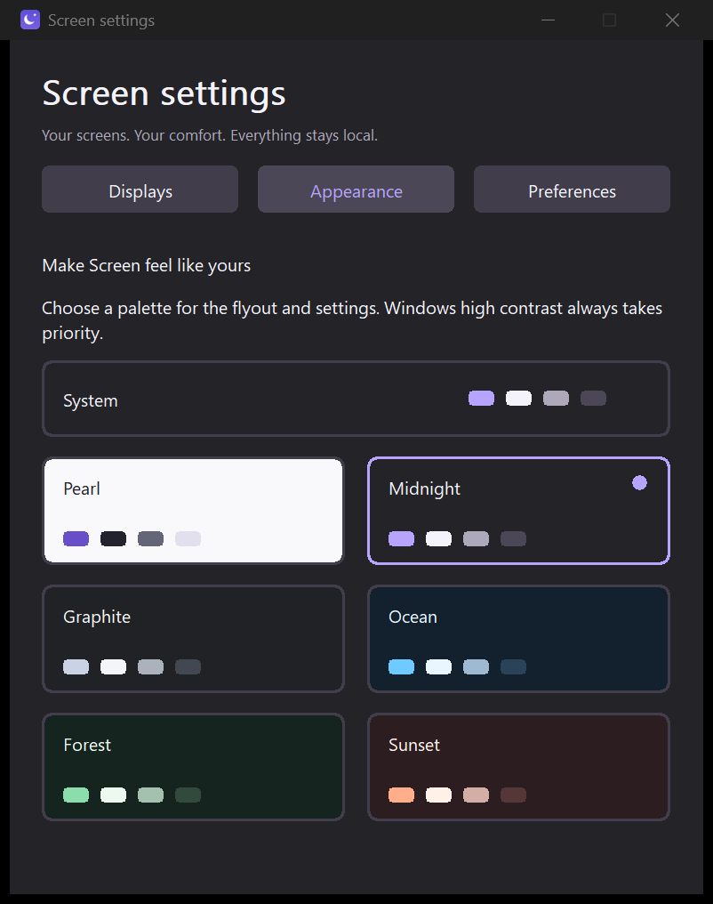
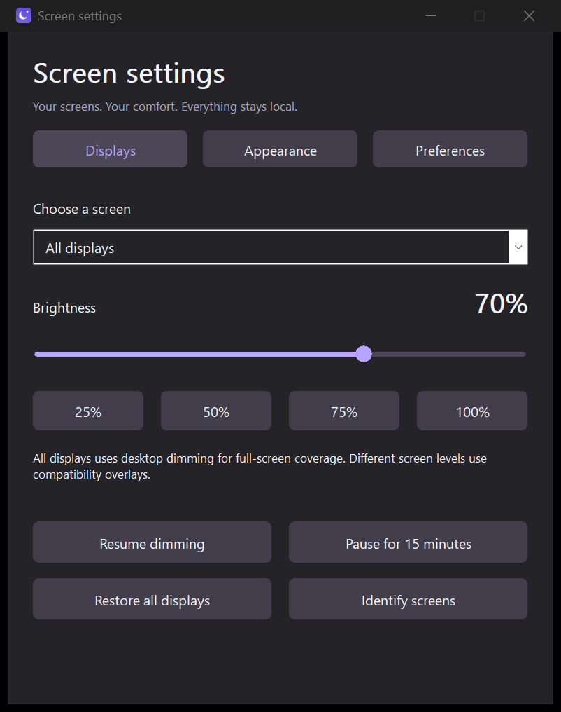
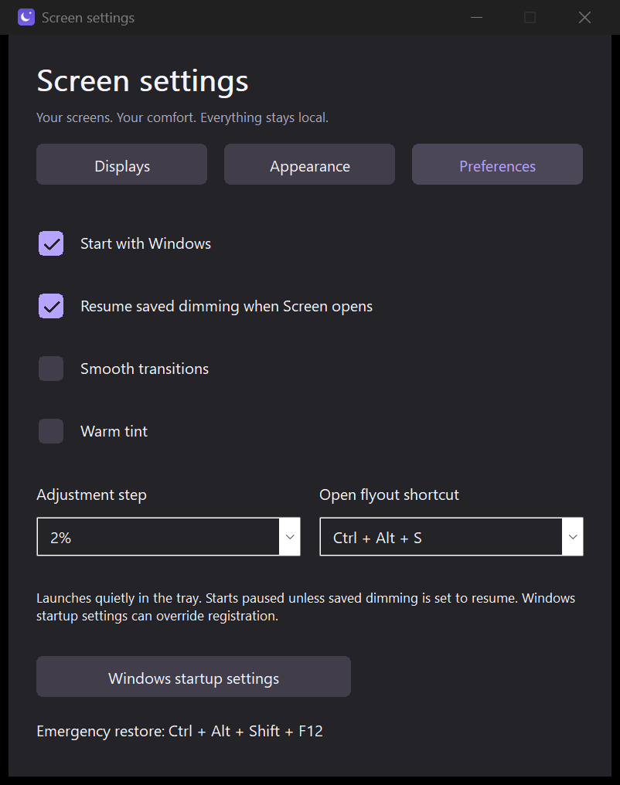
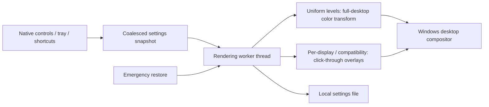

# Screen — a lightweight screen dimmer for Windows 11

**Less glare. More room to focus.**

Software brightness control across your desktop, with smooth fades, per-monitor settings, and a quiet system tray home.

[Get started](#get-started) · [How it works](#how-it-works) · [Build](docs/DEVELOPMENT.md) · [Contribute](CONTRIBUTING.md) · [Privacy](PRIVACY.md)

Screen by **Shardapps** dims Windows desktop output using a full-desktop color transform, with click-through overlays for separate per-display levels and compatibility. Lower the slider to reduce perceived brightness across apps, including ordinary full-screen video app layers. It works independently of a monitor's brightness API and does not change hardware backlight settings.

**Status: Alpha 1 (v1.0.0), available in the [Microsoft Store](https://apps.microsoft.com/detail/9PNHDHKMHDLG).** **Screen Dimmer by Shardapps** is listed under the registered publisher **ShardCoders**. CI also produces per-user setup EXEs, portable ZIPs and Store packages. Unsigned MSIX files require Store signing and are not normal local installers.

**Next update: Alpha 2 (v1.1.0).** Adds Windows virtual desktop profiles, fixes the blank display picker, refines all themes and improves animation pacing. Store publication is pending; [build artifacts](https://github.com/shardapps/screen/actions/workflows/ci.yml) contain developer previews.

**Beta preview: v1.2.0.** Adds optional keyboard sun-key control and a brief, non-activating mini panel labeled **App brightness**, with a separate feedback switch. Start with **Settings → Keyboard → Test brightness keys**; native key control is off by default. OEM Fn keys vary and normal hardware brightness may also change. [Compatibility and setup](docs/BRIGHTNESS_KEYS.md) · [Preview downloads](https://github.com/shardapps/screen/releases).

## Built to stay out of your way

| Feature | What you get |
| --- | --- |
| Native and small | C++20, Win32, and the Windows compositor. No bundled browser or managed runtime. |
| Multi-monitor dimming | Adjust all displays together or select one display. Monitor geometry refreshes when Windows reports a display change. |
| Windows desktop profiles | Opt in under Settings → Desktops. Detect named Task View desktops, save a brightness for each, and keep separate monitor levels inside each profile. |
| Compact flyout | A 330 × 136 panel above the bottom-right taskbar. Open with Alt+S, adjust the slider, then click outside or press Escape. |
| Smooth transitions | Velocity-preserving fades keep moving through rapid slider updates. Short panel transitions respect Windows' animation preference. |
| Six palettes + System | Pearl, Midnight, Graphite, Ocean, Forest and Sunset, shared by the flyout and settings. Windows high contrast takes priority. |
| Proper settings | A screen picker, identify screens, brightness presets, a 15-minute pause, and configurable shortcut/adjustment step. |
| Start with Windows | Opt in to quiet tray startup; separately choose whether to resume saved dimming. |
| Optional warm tint | Add a subtle warm color while dimming. This changes displayed colors. |
| Background controls | Close to the system tray; reopen, pause, restore, or quit from its menu. |
| Keyboard access | Alt+S opens/hides the panel. Native arrow/page keys adjust its slider; global brightness, pause, and emergency restore shortcuts remain available. |
| Recovery by design | Paused startup by default, an 8% brightness floor, immediate emergency restore, and automatic overlay cleanup on exit. |
| Full-screen app coverage | Desktop color processing avoids the overlay's window-order limit; a compatibility renderer remains available. |
| Local and private | No account, telemetry, advertising, network client, or administrator prompt. |

See the actual Windows app

The compact flyout at 150% display scaling. The hero above is an interface illustration.

## Get started

1. Open a successful [Windows CI run](https://github.com/shardapps/screen/actions/workflows/ci.yml). GitHub requires sign-in to download workflow artifacts.
2. Download `Screen-preview-x64` for an Intel/AMD PC, or `Screen-preview-arm64` for Windows on Arm, and extract the artifact ZIP.
3. Quit any older Screen copy from its tray menu, then run **`Screen-Setup-1.1.0-x64.exe`** (or ARM64 setup). It updates the existing per-user installation, adds a Start menu shortcut, and supports uninstall through **Settings → Apps**. Alternatively, extract the portable ZIP completely and run `Screen.exe`. These previews are unsigned; Windows may show an unknown publisher/SmartScreen warning, and managed policies may block them. Review the source/build before running them.
4. Move the slider to enable dimming. Screen starts paused by default. Click the settings icon for **Displays**, **Appearance**, **Preferences** and **Desktops**. Choose a screen directly from the flyout footer or in settings. Enable desktop profiles under Desktops to keep different levels for Task View workspaces. Your selection and preferences are retained.

Alt+S toggles the flyout. Click outside it or press Escape to dismiss it while dimming continues. Choose **Quit** in the tray menu to stop Screen and restore the desktop. `Screen.exe --background` starts quietly in the tray. Enable **Start with Windows** in Preferences to launch at sign-in. **Apply saved brightness when Screen opens** is a separate opt-in; enable both to restore brightness at sign-in. `Screen.exe --paused` overrides it for recovery. Choose Alt+S, Ctrl+Alt+S or Ctrl+Shift+S as the opening shortcut.

**MSIX install error?** `Screen-msix-validation-*` artifacts contain unsigned packages for packaging development. Windows App Installer does not accept them as normal trusted installers. Use the setup EXE or portable app above; see [installation help](docs/INSTALLATION.md).

| Shortcut | Action |
| --- | --- |
| `Alt + S` | Open / hide the brightness flyout (`Ctrl + Alt + S` fallback if reserved) |
| `Ctrl + Alt + D` | Pause / enable dimming |
| `Ctrl + Alt + ↓` | Dim the selected screen(s) by the chosen step (default 5%) |
| `Ctrl + Alt + ↑` | Brighten the selected screen(s) by the chosen step (default 5%) |
| `Ctrl + Alt + Shift + F12` | Immediately restore all displays to 100% and pause |

Other software can reserve a shortcut. The flyout shows the opening shortcut that registered successfully; the tray icon always remains an access path. Selecting **Display → All displays** in the menu and moving the slider replaces per-display overrides.

## How it works

With uniform brightness across all displays, Screen uses Windows' [full-screen color API](https://learn.microsoft.com/en-us/windows/win32/api/magnification/nf-magnification-magsetfullscreencoloreffect). It dims desktop output rather than trying to keep a black window above every app. This covers ordinary full-screen app layers that can bypass a topmost overlay. It changes colors without changing zoom, resolution, pointer coordinates or hardware brightness. The effect also dims Screen's own panel.

Different per-display levels, a busy/unavailable color API, or `Screen.exe --overlay` use the compatibility overlay renderer. The active flyout footer identifies **Desktop** or **Overlay**. Overlay mode retains click-through input and stacking repair, with its narrower full-screen coverage. Both paths animate only during changes and run a small active-only audit; paused and 100% brightness disable that audit. There is no screen capture, driver, or busy loop. See [architecture and safety](docs/ARCHITECTURE.md).

### A measured starting point

Local v0.4.0 x64 samples on Windows 11 build 26200, with one connected display:

| Measurement | Paused | Active desktop dimming at 99% |
| --- | ---: | ---: |
| Process working set | 13.66 MiB | 13.89 MiB |
| Private committed memory | 2.25 MiB | 2.25 MiB |
| Process CPU time over 10 seconds | 0 ms measured | 0 ms measured |

The development executable is about **471 KiB**. Opening native settings measured 19.44 MiB working set and 2.91 MiB private commit. These are individual measurements, **not memory or CPU guarantees**, and exclude compositor/GPU memory. Resolution, display count, drivers, Windows version, and other activity affect results. [Measurement details](docs/PERFORMANCE.md).

## Compatibility and honest limits

- Supported target: Windows 11, x64 and ARM64. No monitor control protocol or vendor SDK is required. ARM64 is cross-built in CI; physical ARM64 validation remains on the release checklist.
- Desktop mode targets composited Windows apps, including full-screen video app layers. Select **All displays** and adjust the slider to clear differing display overrides. The overlay fallback has narrower coverage; other topmost windows can outrank it.
- Protected video, HDR, remote sessions and true exclusive full-screen games require environment-specific testing. No renderer is advertised as covering every Windows or hardware surface.
- Windows' secure desktop, UAC consent screen, sign-in screen, and lock screen are outside the app's scope. Screen restores its desktop effect and hides overlays when the session locks.
- A software overlay changes perceived brightness and color. It does not lower a backlight, guarantee power savings, calibrate a display, or provide a medical benefit.
- Per-display preferences use Windows display device names. Windows can reassign those names after topology or driver changes; check your settings after reconnecting displays.

## Frequently asked questions

**Can Screen dim below my monitor's minimum brightness?**

It can make desktop output look darker using a software color transform or compatibility overlay, even when hardware brightness is already at minimum. The physical backlight remains unchanged.

**Does it work with external monitors?**

Screen enumerates displays through Windows and does not rely on DDC/CI support. It is designed for internal and external displays; unusual adapters, HDR paths, and remote sessions still require testing.

**Can I keep clicking and typing normally?**

Yes. Desktop mode leaves zoom and input coordinates unchanged. The compatibility overlay uses Windows' layered-window input transparency. Neither renderer installs an input hook or takes keyboard focus.

**Does Screen need administrator or kernel permissions?**

No. The executable runs as your current user. The MSIX `runFullTrust` capability describes a desktop app; it does not request elevation.

**Where are settings saved?**

Portable builds use `%LOCALAPPDATA%\Shardapps\Screen\settings.ini`. Packaged Windows installations may virtualize this location. Delete the file while Screen is closed to reset preferences. See [privacy](PRIVACY.md).

**Is Screen available in the Microsoft Store?**

Yes. Get **Screen Dimmer by Shardapps** from the [Microsoft Store](https://apps.microsoft.com/detail/9PNHDHKMHDLG), under publisher **ShardCoders**. See [release evidence](docs/store/ALPHA_RELEASE.md) for validation and compatibility limits.

## Build and contribute

See [development](docs/DEVELOPMENT.md) for Visual Studio 2022/2026, CMake, tests, and packaging. Bugs and focused pull requests are welcome. Read the [contribution guide](CONTRIBUTING.md), [code of conduct](CODE_OF_CONDUCT.md), and [security policy](SECURITY.md).

Screen is published by **Shardapps**, under the [Apache License 2.0](LICENSE). Windows and Microsoft Store are Microsoft trademarks. This project is independent and does not imply Microsoft endorsement.

If Screen makes your workspace more comfortable, star the repo, share a reproducible bug report, or help validate a display setup on the [release checklist](docs/RELEASE_CHECKLIST.md).
