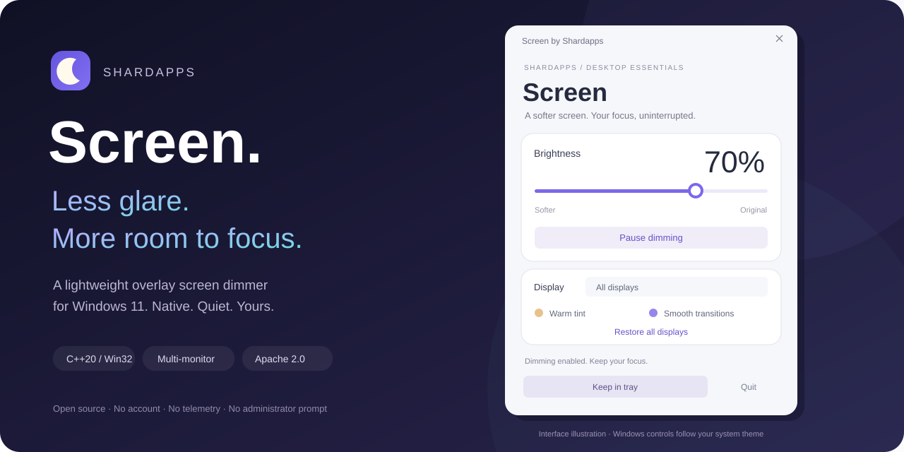
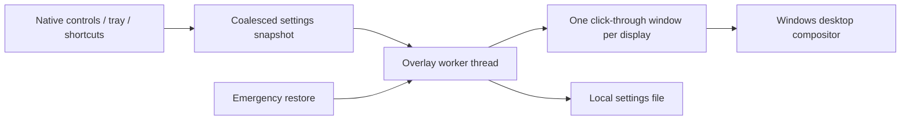

# Screen — a lightweight screen dimmer for Windows 11

**Less glare. More room to focus.**

Software brightness control across your desktop, with smooth fades, per-monitor settings, and a quiet system tray home.

[Get started](#get-started) · [How it works](#how-it-works) · [Build](docs/DEVELOPMENT.md) · [Contribute](CONTRIBUTING.md) · [Privacy](PRIVACY.md)

Screen by **Shardapps** places a transparent, click-through black layer over each display. Lowering the brightness slider makes that layer more opaque, reducing the perceived brightness of ordinary desktop apps together. It works independently of a monitor's brightness API and does not change hardware backlight settings.

**Status: developer preview, v0.1.0.** CI produces per-user setup EXEs and portable ZIPs. Unsigned MSIX files are separate packaging-validation artifacts, not normal installers. Microsoft Store publication and certification are pending; there is no Store listing yet.

## Built to stay out of your way

| Feature | What you get |
| --- | --- |
| Native and small | C++20, Win32, and the Windows compositor. No bundled browser or managed runtime. |
| Multi-monitor dimming | Adjust all displays together or select one display. Monitor geometry refreshes when Windows reports a display change. |
| Smooth transitions | Time-based, 200 ms eased fades. Animation runs on a separate thread and stops when settled. |
| Optional warm tint | Switch the black overlay to a subtle warm color. This changes displayed colors. |
| Background controls | Close to the system tray; reopen, pause, restore, or quit from its menu. |
| Keyboard access | Native keyboard controls, brightness shortcuts, pause, and emergency restore. |
| Recovery by design | Transparent startup, a 15% brightness floor, immediate emergency restore, and automatic overlay cleanup on exit. |
| Local and private | No account, telemetry, advertising, network client, or administrator prompt. |

See the actual Windows app

Paused startup at 150% display scaling. The hero above is an interface illustration.

## Get started

1. Open a successful [Windows CI run](https://github.com/shardapps/screen/actions/workflows/ci.yml). GitHub requires sign-in to download workflow artifacts.
2. Download `Screen-preview-x64` for an Intel/AMD PC, or `Screen-preview-arm64` for Windows on Arm, and extract the artifact ZIP.
3. Run the **`Screen-Setup-0.1.0-x64.exe`** (or ARM64 setup) inside. It installs for your current user, adds a Start menu shortcut, and supports uninstall through **Settings → Apps**. Alternatively, extract the portable ZIP completely and run `Screen.exe`. These previews are unsigned; Windows may show an unknown publisher/SmartScreen warning, and managed policies may block them. Review the source/build before running them.
4. Choose a display and select **Enable dimming**, or move the slider. Screen always starts paused; your saved brightness and preferences are retained.

Closing the window keeps Screen in the tray. Choose **Quit** to stop the app and restore the desktop. `Screen.exe --background` starts in the tray, paused. Automatic startup is not enabled by this preview.

**MSIX install error?** `Screen-msix-validation-*` artifacts contain unsigned packages for packaging development. Windows App Installer does not accept them as normal trusted installers. Use the setup EXE or portable app above; see [installation help](docs/INSTALLATION.md).

| Shortcut | Action |
| --- | --- |
| `Ctrl + Alt + D` | Pause / enable dimming |
| `Ctrl + Alt + ↓` | Dim all displays by 5 percentage points |
| `Ctrl + Alt + ↑` | Brighten all displays by 5 percentage points |
| `Ctrl + Alt + Shift + F12` | Immediately restore all displays to 100% and pause |

Other software can reserve a shortcut. Screen reports registration conflicts in its window; Restore and the tray menu remain available. Selecting **All displays** and moving the slider replaces per-display overrides.

## How it works

The overlay is a standard Windows layered window with transparent input and no activation. Windows routes clicks to the apps underneath. A short timer updates opacity during a fade; there is no continuous animation loop, screen capture, driver, or polling service. See [architecture and safety](docs/ARCHITECTURE.md).

### A measured starting point

One local x64 Release sample on Windows 11 build 26200, with one connected display and Screen paused in the tray:

| Measurement | Result |
| --- | ---: |
| Executable | 389 KiB |
| Process working set | 13.26 MiB |
| Private committed memory | 2.12 MiB |
| Process CPU time over 10 seconds | 0 ms measured |

This is one measurement, **not a memory or CPU guarantee**. It excludes Windows compositor/GPU memory, and does not measure an active dimming surface. Resolution, display count, drivers, Windows version, and other activity affect results. [Reproduce the benchmark](docs/PERFORMANCE.md).

## Compatibility and honest limits

- Supported target: Windows 11, x64 and ARM64. No monitor control protocol or vendor SDK is required. ARM64 is cross-built in CI; physical ARM64 validation remains on the release checklist.
- Intended for ordinary composited desktop apps, including borderless windows. Other topmost windows, protected video, remote sessions, HDR, and exclusive fullscreen apps need environment-specific testing and may bypass or alter the overlay.
- Windows' secure desktop, UAC consent screen, sign-in screen, and lock screen are outside the app's control. Screen hides its overlays when the session locks.
- A software overlay changes perceived brightness and color. It does not lower a backlight, guarantee power savings, calibrate a display, or provide a medical benefit.
- Per-display preferences use Windows display device names. Windows can reassign those names after topology or driver changes; check your settings after reconnecting displays.

## Frequently asked questions

**Can Screen dim below my monitor's minimum brightness?**

It can make the ordinary Windows desktop look darker by adding a software overlay, even when hardware brightness is already at minimum. The physical backlight remains unchanged.

**Does it work with external monitors?**

Screen enumerates displays through Windows and does not rely on DDC/CI support. It is designed for internal and external displays; unusual adapters, HDR paths, and remote sessions still require testing.

**Can I keep clicking and typing normally?**

Yes. The overlay uses Windows' layered-window input transparency and does not take keyboard focus or install an input hook.

**Does Screen need administrator or kernel permissions?**

No. The executable runs as your current user. The MSIX `runFullTrust` capability describes a desktop app; it does not request elevation.

**Where are settings saved?**

Portable builds use `%LOCALAPPDATA%\Shardapps\Screen\settings.ini`. Packaged Windows installations may virtualize this location. Delete the file while Screen is closed to reset preferences. See [privacy](PRIVACY.md).

**Is Screen available in the Microsoft Store?**

Not yet. The repository includes MSIX packaging and [submission instructions](docs/STORE.md). A verified publisher identity, signing/submission, certification, and release QA are still required.

## Build and contribute

See [development](docs/DEVELOPMENT.md) for Visual Studio 2022/2026, CMake, tests, and packaging. Bugs and focused pull requests are welcome. Read the [contribution guide](CONTRIBUTING.md), [code of conduct](CODE_OF_CONDUCT.md), and [security policy](SECURITY.md).

Screen is published by **Shardapps**, under the [Apache License 2.0](LICENSE). Windows and Microsoft Store are Microsoft trademarks. This project is independent and does not imply Microsoft endorsement.

If Screen makes your workspace more comfortable, star the repo, share a reproducible bug report, or help validate a display setup on the [release checklist](docs/RELEASE_CHECKLIST.md).
