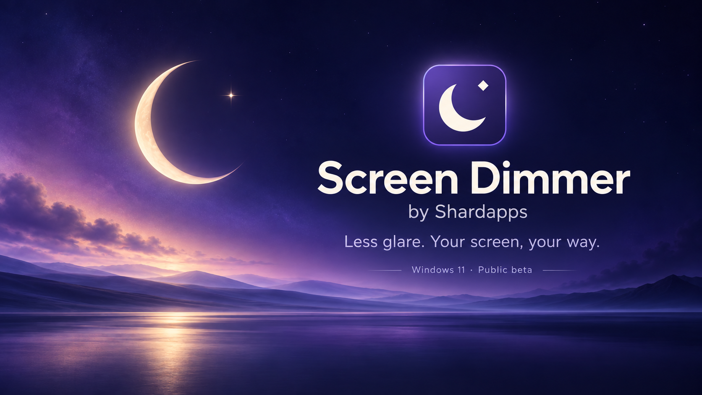
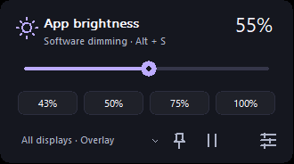
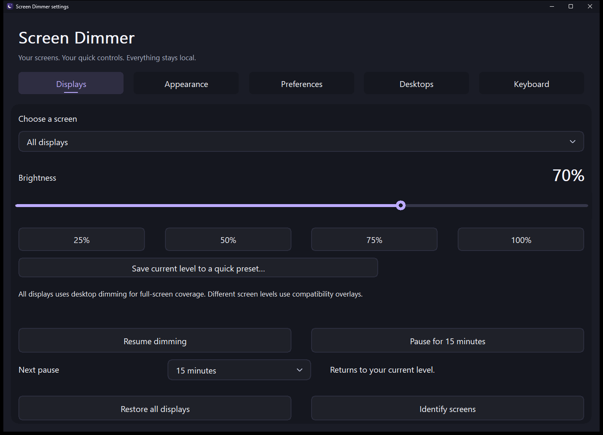
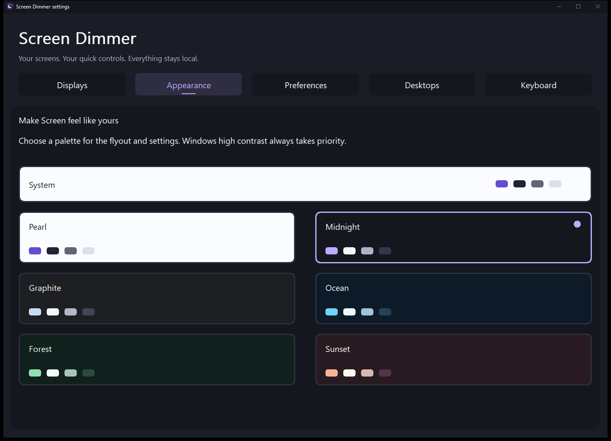
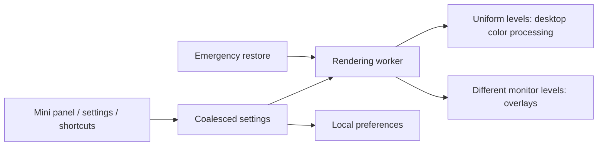

# Screen Dimmer by Shardapps

**Lightweight software brightness control for Windows 11.**

Dim your desktop, save your favorite levels, and get back to what matters.

[Microsoft Store](https://apps.microsoft.com/detail/9PNHDHKMHDLG) · [Public beta downloads](https://github.com/shardapps/screen/releases/tag/v1.3.1-beta.1) · [Quick controls](docs/QUICK_CONTROLS.md) · [Report an issue](https://github.com/shardapps/screen/issues)

Screen Dimmer is a free, open-source Windows 11 utility that reduces **perceived screen brightness through software**. It uses desktop color processing for uniform all-display dimming and click-through overlays for separate monitor levels. It works independently of monitor brightness APIs and leaves the physical backlight unchanged.

Use it for late-night coding, reading and study; an external monitor that still looks too bright at minimum brightness; or different brightness levels for Windows Task View desktops. No account, ads or telemetry. Preferences stay on your device.

**Public beta: 1.3.1.** GitHub setup EXEs and portable ZIPs target x64 and ARM64. The Store update is subject to certification and rollout; check the [release page](https://github.com/shardapps/screen/releases/tag/v1.3.1-beta.1) for status. The Store publisher is **ShardCoders**; the product brand is **Shardapps**.

## Small controls. Useful choices.

| Feature | How it helps |
| --- | --- |
| Mini panel | Alt+S opens a 330 × 184 slider above the taskbar. Pin it across app switches, or dismiss with Escape. |
| Four saved levels | Apply a favorite brightness immediately. Save the current screen level to any slot from Displays settings. |
| Monitors and desktops | Choose all displays or one monitor. Opt in to profiles for named Windows virtual desktops, including monitor overrides. |
| Flexible pauses | Pause/resume in the mini panel, or choose 5/15/30/60 minutes in Settings. A visible countdown stops refreshing when hidden. |
| Six themes + System | Pearl, Midnight, Graphite, Ocean, Forest and Sunset, with native brightness/hover/focus/page motion. Reduced motion and high contrast take priority. |
| Optional brightness keys | Native keyboard input or Windows-linked compatibility, with independently optional App brightness feedback. [Setup](docs/BRIGHTNESS_KEYS.md). |
| Quiet startup | Separate Start with Windows and Apply saved brightness switches; enable both to resume at sign-in. |
| Recovery and privacy | An 8% floor, emergency restore, local settings, no screen or keystroke recording. |

## See the beta

Native mini panel displayed larger for readability. [Gallery and capture provenance](docs/store/beta-1/README.md).

The banner is generated brand artwork. Settings images are native captures; gallery captions identify enlarged interface presentations separately.

## Install and start dimming

1. Get the [Store app](https://apps.microsoft.com/detail/9PNHDHKMHDLG), or **Screen-Setup-1.3.1-x64.exe** / **Screen-Setup-1.3.1-arm64.exe** from the [public beta](https://github.com/shardapps/screen/releases/tag/v1.3.1-beta.1). Choose x64 for Intel/AMD, ARM64 for Windows on Arm. GitHub builds are unsigned previews; managed Windows policies may block them.
2. Quit an older tray copy, then run setup. It installs for the current user and supports Settings → Apps uninstall. Alternatively, extract the portable ZIP completely and run Screen.exe.
3. Press Alt+S and move the slider. Fresh installs start paused. The settings icon opens Displays, Appearance, Preferences, Desktops and Keyboard.
4. For saved brightness at sign-in, enable **both** Start with Windows and Apply saved brightness in Preferences. Windows startup policy takes priority.

Closing the panel keeps dimming active. **Quit** restores desktop output. `Screen.exe --background` starts quietly; `Screen.exe --paused` is a recovery override. Unsigned MSIX artifacts are for Store packaging, not normal local installation. [Installation help](docs/INSTALLATION.md).

| Shortcut | Action |
| --- | --- |
| Alt + S | Open/hide the panel; configurable in Preferences |
| Ctrl + Alt + ↓ / ↑ | Dim/brighten all screens in the current desktop profile by the chosen step |
| Ctrl + Alt + D | Pause/resume |
| Ctrl + Alt + Shift + F12 | Restore all displays, pause and disable Windows-linked following |

If a shortcut is reserved, the tray remains available. Opening alternatives include Ctrl+Alt+S and Ctrl+Shift+S. The panel shows the shortcut that registered.

## Lightweight by design

C++20, Win32 and Windows compositor APIs; no bundled browser, managed runtime, kernel driver or background service. Native controls feed a rendering worker through coalesced snapshots. Transitions run during changes, with no permanent frame loop. Display/desktop detection and optional brightness compatibility use Windows notifications. Marketing artwork stays outside installer/portable payloads.

The 1.3.1 comparison used five interleaved three-second paused-idle samples on one Windows runner: **13.656 MiB working set** in shared mode and **13.828 MiB** with Windows-linked following, versus **13.582 / 13.742 MiB** in matching 1.2.1 modes. Desktop profiles used **20.445 MiB**. These are process measurements, not RAM/CPU guarantees; active rendering and compositor/GPU memory are excluded. [Conditions and current release measurements](docs/PERFORMANCE.md).

## Questions and compatibility

**Can it dim below my monitor's minimum?** It can make desktop output look darker without lowering the backlight. No battery-saving, calibration or medical benefit is promised.

**Does it work with external monitors?** It enumerates Windows displays without requiring DDC/CI or a vendor SDK. Separate monitor levels use overlays with narrower full-screen coverage. Check selection after reconnecting displays because Windows can reassign device names.

**Can each Windows desktop have a different brightness?** Yes. Enable Desktops, switch through Task View normally, and set a level for the detected workspace. Unavailable detection falls back to shared brightness.

**Can my keyboard brightness keys control it?** Sometimes. Opt in to native input, or Follow Windows brightness when Windows exposes logical changes instead of HID key events. Compatibility also follows Windows-slider/automatic changes; it does not intercept Fn firmware or suppress hardware handling. Both modes are off by default. [Compatibility and fallback shortcuts](docs/BRIGHTNESS_KEYS.md).

**Does it cover every full-screen surface?** Uniform desktop mode covers ordinary composited app layers. HDR, protected video, remote sessions and exclusive full-screen games need environment-specific testing. Sign-in, lock and UAC secure screens are excluded. No kernel permissions are needed.

**Can I click and type normally?** Yes. Desktop color processing leaves input coordinates unchanged, and the overlay is click-through. Neither renderer takes typing focus. Optional native input listens for consumer brightness usages without a keyboard hook or typing recorder.

**Which machines are supported?** Windows 11 desktop, x64 and ARM64 packages. ARM64 is cross-built in CI; physical ARM64 and unusual display pipelines remain test limitations.

## Build, contribute and verify

Use Visual Studio C++ desktop tools, a Windows 11 SDK and CMake 3.25+. [Build instructions](docs/DEVELOPMENT.md) cover x64/ARM64. CI checks core/native behavior, desktop cleanup, settings/themes/startup/resources, packaging, install/upgrade/uninstall, memory, portable sanitizers and CodeQL.

Start with [CONTRIBUTING.md](CONTRIBUTING.md), [architecture](docs/ARCHITECTURE.md) and the [code of conduct](CODE_OF_CONDUCT.md). Issues should include app version, Windows build, renderer, display setup and reproducible steps. Use [SECURITY.md](SECURITY.md) for private vulnerability reporting.

[Privacy](PRIVACY.md) · [Apache-2.0](LICENSE) · [Changelog](CHANGELOG.md) · [Citable project facts](docs/PROJECT_FACTS.md) · [Discoverability](docs/DISCOVERABILITY.md)

Made by **Shardapps**. `#ScreenDimmer` `#Windows11` `#OpenSource` `#DesktopApps` `#Shardapps`
